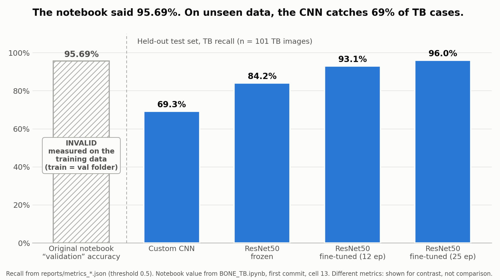
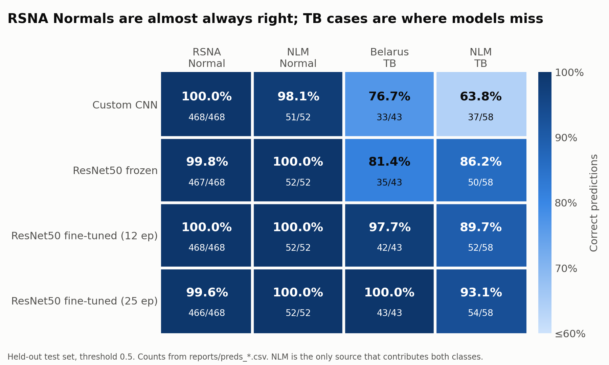

# OsteoDetect: TB Chest X-ray Classifier

[](https://colab.research.google.com/github/aarohi1822/OsteoDetect/blob/main/notebooks/BONE_TB_fixed.ipynb)

This project classifies chest X-rays as **Tuberculosis vs Normal**. It started
as a hackathon notebook ([`BONE_TB.ipynb`](BONE_TB.ipynb)) and was then audited
for data leakage and re-evaluated on a properly held-out test set.

The best model is a fine-tuned ResNet50:
- **96.0 % TB recall** and **99.6 % specificity**, ROC-AUC **0.999**, on 621
  test images it never saw during training
- **93.1 % recall** on the source-matched subset, a harder check described below

> Despite the name, the dataset contains **pulmonary** chest X-rays. It has no
> bone or skeletal TB images.

## Problem

The task is to detect TB from a frontal chest X-ray. The data is the
[TB Chest Radiography Database](https://www.kaggle.com/datasets/tawsifurrahman/tuberculosis-tb-chest-xray-dataset):
4200 PNGs, 3500 Normal and 700 TB.

The original notebook's numbers could not be trusted:

| Issue | Evidence | Consequence |
|---|---|---|
| Validation set = training set | `train_dir` and `val_dir` are the same folder; both print `Found 4200 images` | The reported 95.69 % "validation accuracy" is training accuracy. |
| ResNet50 collapsed | `val_accuracy` is exactly 0.8333 in every epoch, and 3500/4200 = 0.8333 | The model predicted "Normal" for every image. The cause: `/255` input instead of `preprocess_input`, and a fully frozen backbone. |
| No test set, accuracy only | n/a | With classes 5:1 imbalanced, accuracy hides missed TB cases. |
| Earlier README claims | "bone TB vs pulmonary TB", "test accuracy ~92.69 %" | Neither is supported: the classes are Normal vs TB, and there was no test split. |

The dataset itself also creates leakage risks:
- **Duplicates.** 40 pairs are exact copies, near-copies or likely repeat scans
  of the same patient.
- **No patient IDs.** A true patient-level split is impossible.
- **Source confounding.** 88 % of Normal images come from RSNA (US), while TB
  images come from Belarus and NLM. For most images, the source alone predicts
  the label.

## Approach

1. **Duplicate audit** (`src/hash_audit.py`). For every image the script
   computes:
   - the MD5 of the file and of the decoded pixels
   - pHash and dHash perceptual hashes
   - the correlation of 64×64 thumbnails against every other image

   Correlation cut-offs were set by looking at pairs on either side of each
   threshold:

   | Tier | Rule | Pairs |
   |---|---|---|
   | Exact duplicate | identical file or pixel MD5 | 6 |
   | Near-duplicate | thumbnail correlation ≥ 0.985 | 7 |
   | Likely same patient | 0.955 ≤ correlation < 0.985 | 27 |

   Together these form 31 groups covering 68 images. No pair mixes a Normal and
   a TB image. pHash alone missed most same-patient pairs.

2. **Grouped split** (`src/make_split.py`).
   - Each duplicate group counts as one unit, as a stand-in for patient IDs.
   - The split is `StratifiedGroupKFold`, stratified by label × source, at
     70 / 15 / 15 (2954 / 625 / 621 images).
   - The script asserts that no duplicate pair spans two splits.

3. **Models** (`src/train_eval.py`, PyTorch). Same augmentation, batch size 32
   and seed 42 for every model.

   | Model | Recipe |
   |---|---|
   | Custom CNN | The notebook's 3-block CNN, unchanged: `/255` input, Adam lr 1e-4, 15 epochs |
   | ResNet50, frozen | The notebook's recipe: frozen backbone, `/255` input, head only, Adam lr 1e-4, 10 epochs |
   | ResNet50, fine-tuned | ImageNet normalisation → 3 epochs training the head only (lr 1e-3) → unfreeze `layer3`+`layer4` (conv4_x, conv5_x) with AdamW, backbone lr **1e-5**, head lr 1e-4. Up to 12 or 25 epochs, early stopping on val loss, BatchNorm frozen in the frozen stages |

4. **Evaluation.**
   - The checkpoint with the lowest **val** loss is kept.
   - Each model is scored **once** on **test**, with 2000-sample bootstrap
     confidence intervals.
   - Results are also reported on the NLM-only subset, where the image source
     can't predict the label.
   - Decision thresholds are tuned on val only (`src/threshold.py`).

## Results





*Charts generated by `python src/make_figures.py`, which reads the saved
results and exits with an error if any value differs from the values expected
in the script.*

<!-- results:start -->
**Held-out test set** (n = 621: 520 Normal, 101 TB), threshold 0.5, 95% bootstrap CIs in brackets. TB is the positive class.

| Model | Accuracy | Precision | Recall | Specificity | F1 | ROC-AUC | FN / FP |
|---|---|---|---|---|---|---|---|
| Custom CNN (notebook architecture) | 94.8% [93.1–96.5] | 98.6% [95.2–100.0] | 69.3% [60.4–77.8] | 99.8% | 0.814 [0.745–0.872] | 0.975 [0.958–0.989] | 31 / 1 |
| ResNet50, frozen (notebook recipe) | 97.3% [96.0–98.6] | 98.8% [96.1–100.0] | 84.2% [76.5–91.0] | 99.8% | 0.909 [0.861–0.950] | 0.986 [0.973–0.995] | 16 / 1 |
| ResNet50, fine-tuned, 12 epochs | 98.9% [98.1–99.7] | 100.0% [100.0–100.0] | 93.1% [87.9–97.8] | 100.0% | 0.964 [0.935–0.989] | 0.995 [0.986–1.000] | 7 / 0 |
| **ResNet50, fine-tuned, 25 epochs** | 99.0% [98.2–99.7] | 98.0% [94.6–100.0] | **96.0%** [91.8–99.1] | 99.6% | 0.970 [0.944–0.991] | 0.999 [0.997–1.000] | 4 / 2 |

**Source-matched subset** (test images from NLM only, n = 110). NLM is the only source with both classes, so here the image source can't give away the label.

| Model | Accuracy | Recall | Specificity | F1 | ROC-AUC |
|---|---|---|---|---|---|
| Custom CNN (notebook architecture) | 80.0% | 63.8% | 98.1% | 0.771 | 0.962 |
| ResNet50, frozen (notebook recipe) | 92.7% | 86.2% | 100.0% | 0.926 | 0.991 |
| ResNet50, fine-tuned, 12 epochs | 94.5% | 89.7% | 100.0% | 0.945 | 0.992 |
| ResNet50, fine-tuned, 25 epochs | 96.4% | 93.1% | 100.0% | 0.964 | 0.997 |

**Correct predictions by source and class** (test, threshold 0.5). Almost every error is a missed TB case. RSNA Normals, the bulk of the Normal class, are nearly always right.

| Model | RSNA Normal | NLM Normal | Belarus TB | NLM TB |
|---|---|---|---|---|
| Custom CNN (notebook architecture) | 468/468 | 51/52 | 33/43 | 37/58 |
| ResNet50, frozen (notebook recipe) | 467/468 | 52/52 | 35/43 | 50/58 |
| ResNet50, fine-tuned, 12 epochs | 468/468 | 52/52 | 42/43 | 52/58 |
| ResNet50, fine-tuned, 25 epochs | 466/468 | 52/52 | 43/43 | 54/58 |

**Threshold chosen on val, applied to test** (`sens95` = highest threshold with ≥ 95% recall on val; `youden` = max sensitivity + specificity − 1 on val).

| Model | Rule | Threshold | Test recall | Test specificity | Test F1 | FN / FP |
|---|---|---|---|---|---|---|
| Custom CNN (notebook architecture) | youden | 0.217 | 83.2% | 99.6% | 0.898 | 17 / 2 |
| Custom CNN (notebook architecture) | sens95 | 0.010 | 94.1% | 85.6% | 0.701 | 6 / 75 |
| ResNet50, frozen (notebook recipe) | youden | 0.278 | 91.1% | 98.1% | 0.906 | 9 / 10 |
| ResNet50, frozen (notebook recipe) | sens95 | 0.097 | 95.0% | 91.3% | 0.793 | 5 / 45 |
| ResNet50, fine-tuned, 12 epochs | youden | 0.151 | 96.0% | 99.6% | 0.970 | 4 / 2 |
| ResNet50, fine-tuned, 12 epochs | sens95 | 0.451 | 94.1% | 99.6% | 0.960 | 6 / 2 |
| ResNet50, fine-tuned, 25 epochs | youden | 0.168 | 97.0% | 99.6% | 0.975 | 3 / 2 |
| ResNet50, fine-tuned, 25 epochs | sens95 | 0.168 | 97.0% | 99.6% | 0.975 | 3 / 2 |
<!-- results:end -->

*Tables generated by `python src/results_table.py --write` from
`reports/metrics_*.json`, `reports/preds_*.csv` and `reports/thresholds.json`.*

- **Accuracy hides missed TB cases.** The custom CNN scores 94.8 % accuracy but
  misses 31 % of TB cases. Recall is the number that matters for screening.
- **Proper fine-tuning is the biggest gain.** Fine-tuning the top ResNet50
  stages lifts test recall from 84 % to 96 % compared with the notebook's
  frozen recipe. With a threshold chosen on val (0.168), it reaches 97 % recall
  with 2 false positives. The CNN needs 75 false positives to reach similar
  recall.
- **The source-matched check is harder for most models.** On the NLM subset,
  recall falls for the CNN (69.3 % → 63.8 %) and for both fine-tuned ResNet50
  runs (best: 96.0 % → 93.1 %). The frozen ResNet50 is the exception
  (84.2 % → 86.2 %). With only 58 NLM TB images, differences of a few points
  are within noise.
- **Every model gets RSNA Normals almost perfectly right** (466–468 of 468).
  This group is most of the Normal class, and it comes from a single source,
  which is consistent with the models partly recognising the source.

## How to run

**Colab:** open [`notebooks/BONE_TB_fixed.ipynb`](notebooks/BONE_TB_fixed.ipynb)
with the badge above. It is a self-contained Keras version: the same
duplicate grouping and grouped split, the CNN plus the fine-tuned ResNet50, and
a single test evaluation. It needs a `kaggle.json`.

- It was smoke-tested end to end with TensorFlow 2.21 on a 5 % subsample at
  1 epoch. A full Colab run has not been done.
- Its split is numbered slightly differently, so its numbers will not match the
  tables above exactly.

**Local** (Python 3.12; Apple MPS, CUDA or CPU):

```bash
python3 -m venv .venv && source .venv/bin/activate
pip install -r requirements.txt

kaggle datasets download -d tawsifurrahman/tuberculosis-tb-chest-xray-dataset -p data
unzip -q data/tuberculosis-tb-chest-xray-dataset.zip -d data/raw

python src/hash_audit.py                 # duplicate audit -> reports/duplicate_pairs.csv, dup_groups.csv
python src/make_split.py                 # grouped split   -> reports/splits.csv
python src/train_eval.py cnn             # each model      -> reports/metrics_<model>.json, preds_<model>.csv
python src/train_eval.py resnet_frozen
python src/train_eval.py resnet_ft
python src/train_eval.py resnet_ft25
(cd src && python threshold.py cnn resnet_frozen resnet_ft resnet_ft25)   # -> reports/thresholds.json
python src/results_table.py --write      # refresh the Results section above
python src/make_figures.py               # -> assets/before_after.png, assets/source_heatmap.png
```

Runtimes on an M2 MacBook Air (8 GB): hashing about 30 s, CNN about 5 min,
frozen ResNet50 about 9 min, fine-tuned ResNet50 about 21 min (12 epochs) or
35 min (25 epochs).

```
BONE_TB.ipynb             original hackathon notebook (kept for reference)
notebooks/                corrected Colab notebook + make_notebook.py, which generates it
src/                      audit, split, training/evaluation, thresholds, results table
reports/                  splits, duplicate lists, metrics, per-image test predictions, training logs
requirements.txt          pinned versions used to produce reports/
```

## Limitations

- **Source confounding.**
  - Normal images are mostly RSNA; TB images are Belarus and NLM.
  - The models may partly be recognising the hospital or scanner rather than TB.
  - The headline test numbers are therefore optimistic. The NLM-only subset is
    the fairer check, but with only 110 images its estimates are imprecise.
- **No patient IDs.** Groups come from image similarity. Repeat scans of one
  patient that look different (correlation < 0.955) can still land in
  different splits. RSNA images come from NIH ChestX-ray14, which has many
  follow-up scans per patient.
- **No external validation.** All data comes from one curated Kaggle dataset.
  Performance on images from other hospitals or populations is unknown, and is
  probably lower.
- **A single split and seed.** The confidence intervals cover variation in which
  test images were sampled, but not variation from training or from how the
  data was split.
- **Thresholds and calibration.** Thresholds were tuned on only 625 val images
  from the same sources as test, and the predicted probabilities are not
  calibrated.
- **Labels.** Labels are image-level and inherited from the source datasets.
  There was no radiologist re-read and there is no localisation ground truth.
- **Horizontal flip augmentation** (kept from the notebook so results stay
  comparable) produces anatomically impossible images, with the heart on the
  right.
- **Framework port.**
  - The numbers above come from PyTorch ports of the Keras models.
  - In PyTorch, the frozen `/255` ResNet50 still learns. The Keras collapse is
    specific to Keras's caffe-style preprocessing.
  - The original Colab `.h5` models could not be evaluated, because they were
    trained on all 4200 images.
- **Not a medical device.** This is a research and educational prototype. Do
  not use it for diagnosis.

## Citation

T. Rahman et al., "Reliable Tuberculosis Detection using Chest X-ray with Deep
Learning, Segmentation and Visualization," *IEEE Access*, vol. 8,
pp. 191586–191601, 2020. [doi:10.1109/ACCESS.2020.3031384](https://doi.org/10.1109/ACCESS.2020.3031384)
